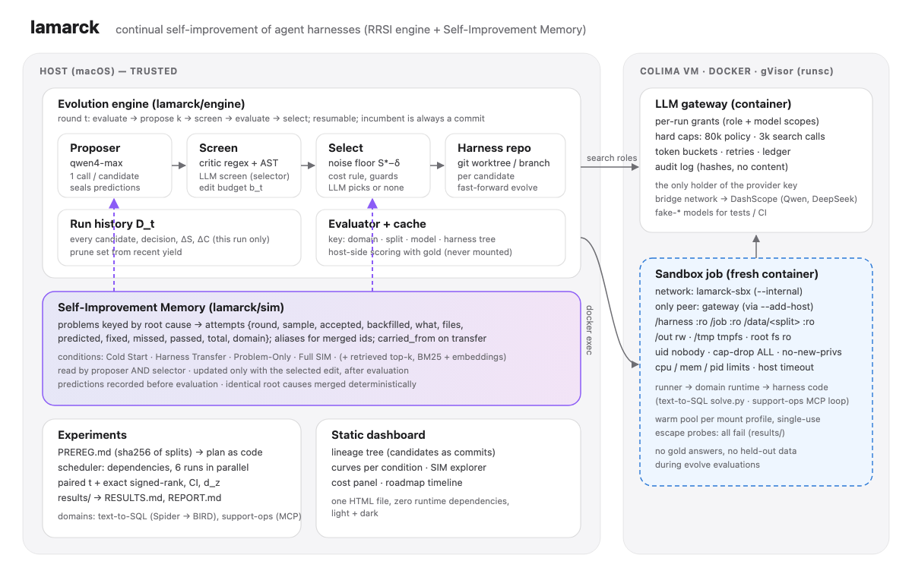

# lamarck

Continual self-improvement of LLM agent harnesses: an independent, open-source implementation of
**Self-Improvement Memory (SIM)** (Yu et al., arXiv 2611.18856; the paper ships no code) on a
regularized evolutionary code-harness engine in the style of RRSI (Xia et al., arXiv 2609.24972),
with a gVisor-sandboxed evaluation layer and a budgeted LLM gateway that prices every call in RMB.

An LLM *proposer* edits an agent's harness (prompts, configuration, control code); every candidate is a
git branch, evaluated in a fresh gVisor container whose only network peer is the gateway; a *selector*
picks among the candidates that hard rules admit. Each accepted edit is recorded in SIM by root cause,
with the tasks it was predicted to fix sealed **before** evaluation. When the benchmark or the policy
changes (continual RSI, CRSI), the harness and its memory are carried over.



> **Status (2026-11-19).** Engine, SIM, gateway, sandbox, both domains, the experiment pipeline, the
> dashboard and the report are done. The experiments ran at **pilot scale** on RMB 8.18 (budget-revised
> plan, PREREG deviation 3): one cheap model (`qwen3.8-flash`) in every role, 3 rounds × 2 candidates,
> 15-40-task splits, a 3-pair primary paired study, extended to 7 pairs as a separate, secondary analysis
> (deviation 5). At that scale **the data show no benefit of SIM**, and they could not have shown a small
> one either way; see the results below and [REPORT.md](REPORT.md).
> Not the first open-source code inspired by SIM (see [Prior art](#prior-art)).

## Results (pilot scale)

Every number is generated by `make report` from files under `results/`; the full tables are in
[results/RESULTS.md](results/RESULTS.md), the raw run files in `results/runs/`.

| question | result | source (`results/summary.json` unless noted) |
|---|---|---|
| Source RSI on Spider (7 runs, 30 evolve / 40 held-out tasks) | evolve 83.3 → 86.7-93.3 in every run; held-out 80.0 → 77.5, 77.5, 77.5, 82.5, 80.0, 80.0, 85.0 (mean **80.0**): no held-out gain on average | `source` |
| Source RSI on support-ops (1 run, 20 / 20 tasks) | evolve 75.0 → 95.0, held-out 80.0 → 95.0 | `source` |
| **RQ1, primary** (deviation 3): Full SIM − Harness Transfer on BIRD held-out (40 tasks), n = 3 | Δ = 0.0, −10.0, +5.0; mean **−1.67** points, 95% CI [−20.6, +17.3], t(2) = −0.38, p = 0.74; exact signed-rank p = 1.0 (with 3 pairs the smallest attainable p is 0.25) | `paired` |
| RQ1, **extended, secondary** (deviation 5: pairs 4-7 added after seeing the primary result) | n = 7: Δ = 0.0, −10.0, +5.0, 0.0, −2.5, 0.0, 0.0; mean **−1.07**, 95% CI [−5.3, +3.1], t(6) = −0.63, p = 0.55; exact signed-rank p = 0.75; SIM wins 1, loses 2, ties 4 | `paired_extended` |
| Four conditions, Spider → BIRD (single runs) | Cold Start 67.5 → 65.0 · Harness Transfer 55.0 → 60.0 · Problem-Only 55.0 → 65.0 · Full SIM 55.0 → 60.0 | `conditions.sql` |
| Harness transfer itself | 6 of 7 Spider-evolved harnesses started **below** the seed harness on BIRD held-out (55.0-65.0 vs 67.5; source 7: 72.5) | `paired_extended.pairs[].start`, `conditions.sql` |
| Four conditions, support-ops standard → shifted policy | all four at **100.0** on the 15-task shifted held-out split before and after: a ceiling, uninformative | `conditions.supportops` |
| Retrieval ablation (pooled SIM of the 3 sources) | full pooled SIM 55.0 → 65.0, top-4 retrieved 55.0 → 62.5 (one seed each) | `retrieval` |
| Evaluation noise at temperature 0 | the same harness scored 60.0 and 55.0 (also 67.5 / 62.5 and 65.0 / 70.0) on the same 40 held-out tasks; repeat-evaluation sd up to 5.8 points on 30 BIRD tasks | `paired_raced`, `eval_variance` |
| A flash model as proposer | 180 candidate slots → 155 usable proposals (16 had no file blocks) → 93 evaluated after the screen → 37 accepted | `search` |
| Money | **RMB 8.181** of the RMB 9.50 hard cap, 7,563 calls (RMB 5.384 for the primary plan, RMB 2.797 for the extension); 55% of policy prompt tokens were served from the provider's cache | `results/budget/spend_ledger.json`, `results/cost.json` |

The cross-model condition (a qwen-evolved harness continued with a DeepSeek policy) is implemented and
exercised end to end with simulated model families in the offline tests, but was **not run** with real
models (no budget). One pre-revision source run with `qwen4-max` as proposer (full 60/120-task splits)
went 78.3 → 88.3 on Spider evolve and 81.7 → 86.7 on held-out; it is reported separately in
`results/pre_revision/` (it is not the revised plan's `sql-src-4`).

**Study 2: strong search model (run 2026-11-20 UTC; runs 1-5 on an AWS EC2 Graviton host, runs 6-10 on macOS/colima).** A separate follow-up,
pre-registered before any of its runs (PREREG.md, "Study 2"): five Spider source runs with `qwen4-max` as
proposer and selector and everything else as in `sql-src-1..7`, to test whether the flash search model was the
bottleneck. All five finished. Held-out change per run: 0.0, 0.0, +5.0, +5.0, +2.5 (mean **+2.5** points) vs the
seven flash-search controls' mean 0.0. Against 0: t(4) = 2.24, p = 0.089, 95% CI [−0.6, +5.6] (exact
signed-rank p = 0.25). Against the controls: +2.5, Welch p = 0.14, 95% CI [−1.0, +6.0] (exact Mann-Whitney
p = 0.18). **A positive trend, not a significant effect** at n = 5: the steps are 2.5 points on 40 tasks and
the evaluation noise is of the same order; the controls ran a day earlier (not randomized). Evolve-split gain
was similar (mean +6.0 vs +7.1), with one accepted edit per run. RMB 5.62 of its RMB 9.00 cap, 1,025 calls.
**Extended analysis (secondary, not confirmatory):** five more runs (`s2-src-6..10`, seeds 16-20) were added
*after* seeing the n = 5 result (optional stopping; PREREG Study 2 deviation 1, cap raised to RMB 15.00) and ran
on macOS/colima instead of EC2 (host and batch confounded); all five finished, with held-out changes +7.5, 0, +2.5,
0, 0, so over all ten runs the mean is +2.25, t(9) = 2.59, p = 0.029, 95% CI [+0.3, +4.2] (exact signed-rank
p = 0.062), and +2.25 vs the controls, Welch p = 0.13 (exact Mann-Whitney p = 0.12); the n = 5 analysis above
remains the primary result. Study 2 total: RMB 11.17 of RMB 15.00, 1,944 calls.
Tables: [results/study2/RESULTS.md](results/study2/RESULTS.md); raw: `results/study2/summary.json`.

**Study 3: confirmatory replication of Study 2 (run 2026-11-20 UTC on macOS/colima; stopped by the provider at
5 of 10 runs).** Pre-registered before any of its runs (PREREG.md, "Study 3"): ten new runs `s3-src-1..10`
(seeds 21-30), configuration equal to Study 2's except run ids and seeds, fixed n, primary test one-sided
one-sample t of the held-out change vs 0 (α = 0.05). During the run the DashScope account stopped serving both
models (HTTP 403 `AccessDenied.Unpurchased`, the account-credit error), so `s3-src-5` and `s3-src-7` ended in
`infra_error` (no endpoint, nothing imputed) and `s3-src-8..10` were never launched. **n = 5 finished**
(`s3-src-1, 2, 3, 4, 6`), with held-out changes 0, +2.5, +5.0, +2.5, +7.5 (mean **+3.5** points): one-sided
t(4) = 2.75, p = 0.026; two-sided p = 0.052, 95% CI [−0.04, +7.04]; exact signed-rank p = 0.125 two-sided,
0.0625 one-sided. **Verdict by the pre-registered rule, on the five finished runs: replicated.** It is a
fragile result: half the planned n, the two-sided interval just includes 0 and the rank test does not reach
0.05. Secondary: +3.5 vs the seven flash controls (not randomized, run a day earlier), Welch p = 0.067, exact
Mann-Whitney p = 0.068; evolve change mean +7.3 (controls +7.1). RMB 7.86 of its RMB 15.00 cap (the ledger
cap was never reached; the provider balance ran out first), 1,325 calls (18 failed, all 403s in the two
stopped runs). Whether to resume `s3-src-5`/`s3-src-7` under the outage rule and launch `s3-src-8..10` after a
top-up is not decided. Tables: [results/study3/RESULTS.md](results/study3/RESULTS.md); raw:
`results/study3/summary.json`.

## What is in the box

| component | what it does | code |
|---|---|---|
| Engine | candidates as git branches/worktrees; RRSI regularizers: annealed edit budget, calibrated noise band, cost rule, deterministic critic + LLM screen, prune set; resumable rounds | `lamarck/engine/` |
| SIM | App. D.3 record (problems keyed by root cause, attempts with sealed predictions, fixed / missed), deterministic merge with aliases, four memory conditions, top-k retrieval (BM25 + embeddings, RRF, token budget) | `lamarck/sim/` |
| Gateway | per-run grants, call caps, token buckets, retries, audit log without content; **RMB spend ledger**: worst-case reservation before each call, settlement from the returned usage (cached tokens at the cached rate), hard cap, fail-closed on unknown models | `lamarck/gateway/` |
| Sandbox | fresh gVisor (`runsc`) container per evaluation, read-only root and mounts, no capabilities, CPU / memory / pid limits, internal-only network to the gateway, escape probes | `lamarck/sandbox/`, `results/sandbox_probes.json` |
| Domains | text-to-SQL (Spider → BIRD mini-dev, execution accuracy on read-only SQLite) and support-ops (MCP tool environment, standard → shifted refund policy); gold answers never enter the sandbox | `lamarck/domains/` |
| Experiments | the pre-registered plan as code; a scheduler with a **money gate** (a run starts only if the money left covers it and every higher-priority run); paired statistics checked against the paper's Table 3 | `lamarck/experiments/`, `PREREG.md` |
| Dashboard | one static HTML file: paired study, curves, harness lineage, SIM explorer, cost, roadmap timeline | `docs/dashboard/index.html` |

## How the experiment stayed honest

- **Pre-registration.** `PREREG.md` was committed before the first experiment; five deviations are
  appended with dates and with what had been seen when each was decided. The calibrated noise band
  first rejected every candidate (deviation 2); the provider account ran out of credit mid-run while
  403s were being scored as wrong answers (deviation 3, `results/validity.json`); parallel arms raced on
  a shared evaluation and were re-run after a cross-process lock fix, with the flawed execution still
  reported (deviation 4); four extra pairs were added after the primary result was known, so they form a
  separate, labelled analysis that does not replace the primary one (deviation 5).
- **Held-out never reaches the search.** Only evolve-split scores and traces are shown to the proposer
  and selector; a test checks every prompt.
- **Predictions are sealed.** The proposer's manifest is on disk before the candidate is evaluated.
- **Provider failures are not scores.** Evaluations that saw a gateway or provider error are discarded
  and never cached.
- **Money is enforced, not estimated.** The cap cannot be crossed even with concurrent calls (tests).

## Reproduce

```bash
uv sync                      # Python 3.13
make ci                      # ruff, mypy, 106 offline tests with fake models (no network, no key)
make test-docker             # sandbox + escape probes (colima + Docker, gVisor if installed)
scripts/reproduce.sh         # the budget-revised experiments: API check, gateway, schedule, report
make report                  # rebuild results/ and the dashboard from runs/rev3
make dryrun-study2           # Study 2 launcher end to end, offline (simulated upstream, temp root)
scripts/run_study2.sh        # Study 2 for real (qwen4-max search; RMB 15.00 cap in its own ledger)
scripts/run_study3.sh        # Study 3 for real (fixed-n replication; RMB 15.00 cap in its own ledger)
```

Data: `scripts/prepare_text2sql_splits.py` (Spider 1.0 and BIRD mini-dev archives, hashes in
PREREG.md), `scripts/prepare_supportops_splits.py`, `scripts/prepare_subsplits.py`. The API key is read
by the gateway process only, from `./.env` (or the file named by `$LAMARCK_KEYFILE`); nothing else ever sees it. `PROGRESS_LOG.md` has
the operational notes (gVisor re-registration after a colima restart, how to resume a schedule).

## Prior art

SIM-inspired code already existed when this project started (searched 2026-11-18):
`crimeacs/auto-improve` (a `--sim` flag for a text-artifact improver, 4-pair study) and
`JosephOIbrahim/Synapse` (`harness/sim`, not wired up). lamarck's contribution is an independent
implementation of the full CRSI protocol (four conditions, paired design) on a regularized code-harness
engine with sandboxed evaluation and enforced budgets. Notes for the paper authors: [UPSTREAM.md](UPSTREAM.md).

## Limitations

Pilot scale (3 primary / 7 extended pairs, 3 rounds, 2 candidates, 15-40 tasks), one model family, a flash model as
proposer, a support-ops target split at ceiling, no cross-model run with real models. See
[REPORT.md](REPORT.md) §Threats to validity. A reading guide for the code (Chinese) is in
[INTERVIEW.md](INTERVIEW.md).

License: Apache-2.0 (see [LICENSE](LICENSE)).
